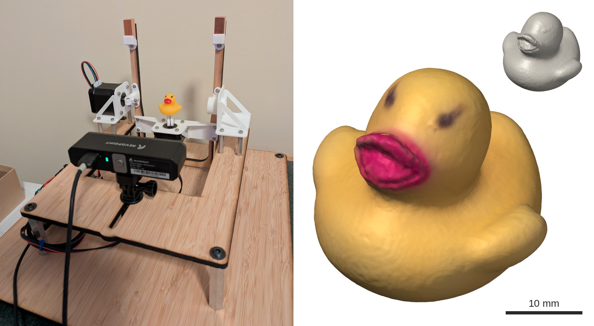

# revopoint-lat-lon-scanner

A two-axis stage that turns an object in front of a fixed Revopoint MINI 3D
scanner: a turntable (longitude) carried on a tilting cradle (latitude). Both
axes are stepper motors driven by a BigTreeTech SKR Mini E3 V3.0.



Left: the stage, with the scanner in front and a rubber duck on the turntable.
Right: a mesh of the duck, made from its scanned point cloud
([`examples/duck_point_cloud.ply`](examples/duck_point_cloud.ply)) with Open3D's
Poisson surface reconstruction.

- [`firmware/`](firmware/) - Marlin configuration and build script for the
  board, which then takes G-code over USB. Licensed separately under the GPLv3.
- [`lat_lon_scanner/`](lat_lon_scanner/) - Python package that drives the stage
  and the scanner.
- [`cad/`](cad/) - FreeCAD models of the stage, the DXF and STL files sent out
  for fabrication, and the bill of materials.
- [`examples/`](examples/) - some example scans, as point clouds.
- [`notes/agent-guide.md`](notes/agent-guide.md) - a guide for AI agents working with this repository.

## Requirements

All access to the scanner goes through
[revopoint-python](https://github.com/HazenBabcock/revopoint-python), which
talks to the Revopoint MINI over WiFi: depth capture, exposure control and its
calibration files. It is not on PyPI, so install it from a checkout first:

```bash
git clone https://github.com/HazenBabcock/revopoint-python.git
pip install -e revopoint-python
```

Then install this package, with the extras for reconstruction and tests:

```bash
pip install -e ".[reconstruct,test]"
```

## Scanning

After powering up the stage, energize the motors, push the cradle upright by
hand (the motors hold it there), and declare that pose as zero:

```bash
python -m lat_lon_scanner.stage zero
```

Then scan. Each run goes to `~/Data/revopoint/<date>/<name>/`, with one `.npz`
per view holding the depth frames and stereo images at each exposure:

```bash
python -m lat_lon_scanner.capture duck
```

The default plan is latitudes +90, +60, +30, 0 and −20, with each row's
longitudes spaced so neighboring views are about 30° of arc apart on the sphere
(`--spacing`): 1, 6, 10, 12 and 11 views, 40 in all at about 15 s each. Each
view captures 4 depth frames at each of three exposures (12000, 24000, 40000).
`python -m lat_lon_scanner.stage` also takes `position`,
`move <latitude> <longitude>` and `release`.

## Reconstruction

```bash
python -m lat_lon_scanner.reconstruct ~/Data/revopoint/<date>/duck
```

This needs the `reconstruct` extras (Open3D, SciPy) and writes
`reconstruction/` inside the run: `point_cloud.ply` (positions in mm, normals,
and the scanner's grayscale brightness as color), `stage_axes.json`, and
`preview_*.png` renderings from six directions.

The stage needs no separate calibration. The two rotation axes are fitted from
the scan itself, by minimizing how far neighboring views disagree once each is
turned back by its commanded angles. On the first duck scan the axes came out
0.5 mm from intersecting, and neighboring views agreed to about 0.3 mm. Each
view is filtered (pixels at depth edges and surfaces seen nearly edge-on are
dropped), the views are merged, and the result is cropped to the object: the
post and cap it sits on are found as a stack of cylinders on the turntable axis
and cut away. Red and yellow surfaces reflect little of the scanner's blue
light, so expect holes there (the duck's beak).

An object on a soft mount also tips as the cradle tilts. The bust, held on its
cap by a gel pad about 0.5 mm thick, leaned toward the scanner at high
latitudes and away at negative ones, which left its head in layers 1–2 mm
apart. So after the axes, the reconstruction fits a nod that grows with the
gravity load, gain × sin(latitude), about a pivot on the turntable axis, and
then refits the axes with it. For the bust the nod came out 2.5° at latitude 90,
and the misalignment of views up to 70° apart fell from 0.53 to 0.46 mm; for
the duck it was 0.5°, with little effect. Fitting the nod doubles the
reconstruction time (42 minutes for the bust's 88 views).

### Filling in a dark area

A dark area, such as the duck's red beak, keeps getting depth at longer
exposures after the rest of the object has stopped improving. Rather than
rescanning everything, scan just that area at 60000 (the top of the scanner's
useful range) as a second run, without moving the scanner or re-zeroing the
stage, then merge it in:

```bash
python -m lat_lon_scanner.capture duck_beak --exposures 60000 \
    --poses "-15:-37 -15:-22 -15:-7 -15:8 -15:23 0:23 0:8 0:-7 0:-22 0:-37"
python -m lat_lon_scanner.reconstruct ~/Data/revopoint/<date>/duck \
    --extra-runs ~/Data/revopoint/<date>/duck_beak --output-name reconstruction_with_beak
```

The extra run's views are placed using the axes fitted from the main run. For
the duck, 20 views around the beak took 3 minutes, lined up with the main scan
as well as its own views do (about 0.1 mm), and nearly doubled the points
within 5 mm of the beak's center.

### Larger objects

The duck was scanned with the scanner at the front of its mount slot, which
puts the rotation center about 120 mm away; there the view is only about
54 mm tall. For a larger object, slide the scanner back along the slot. At the
back the rotation center is about 176 mm away, the view about 79 mm tall, and
a bust about 70 mm tall fit at every pose from latitude −20 to +90. The
scanner's working distance is 100–200 mm.

The reconstruction defaults are set for the duck, so give it the new distances:

```bash
python -m lat_lon_scanner.reconstruct ~/Data/revopoint/<date>/bust --depth-range 100 215 --crop-radius 55
```

`--depth-range` keeps depth readings between those distances from the scanner,
in mm (default 73–194). `--crop-radius` keeps points within that distance of
the rotation center, in mm (default 32).

## Tests

```bash
python -m pytest tests
```

## Stage conventions

Positions are in degrees. Zero is the cradle upright (turntable axis vertical),
set with `G92 X0 Y0` after each power-up since there are no limit switches.

| Axis | Motion | Positive direction | Hard limit | Scanning range |
|---|---|---|---|---|
| X | Latitude (tilt) | Top of the stage tilts toward the scanner | ±90° | +90° to −20° |
| Y | Longitude (turntable) | Counterclockwise seen from above (cradle upright) | None | Any |

- The latitude hard limit is set by the longitude motor's cable, which winds
  onto the apparatus beyond ±90°.
- Below −20° the scanner mostly sees the underside of the mount and the
  turntable plate.
- Turning the object counterclockwise moves the scanner's viewpoint clockwise
  around it, so +Y lowers the viewpoint's longitude on the object.

## CAD

[`cad/`](cad/) has the FreeCAD 1.1 models of the stage, the files sent out for
fabrication, and the bill of materials
([`scanner_mount_bom.xlsx`](cad/scanner_mount_bom.xlsx)). The assemblies also use models that can't be redistributed
here, so FreeCAD opens them with those parts missing:

- The scanner, from [Revopoint Mini](https://grabcad.com/library/revopoint-mini-1)
  and [Revopoint - Pop 3 Set](https://grabcad.com/library/revopoint-pop-3-1) on
  GrabCAD.
- The control board, from BigTreeTech's
  [SKR Mini E3 repository](https://github.com/bigtreetech/BIGTREETECH-SKR-mini-E3/tree/master/hardware/BTT%20SKR%20MINI%20E3%20V3.0/3D).
- The example object, from
  [Small bust scanned with Revopoint MINI](https://grabcad.com/library/small-bust-scanned-with-revopoint-mini-1)
  on GrabCAD.
- The motors and hardware, from McMaster-Carr.

[`cad/README.md`](cad/README.md) lists each missing file and McMaster-Carr part
number.

## License

MIT (see `LICENSE`), except `firmware/`, which is derived from Marlin and
licensed under the GPLv3 (see `firmware/LICENSE`).
