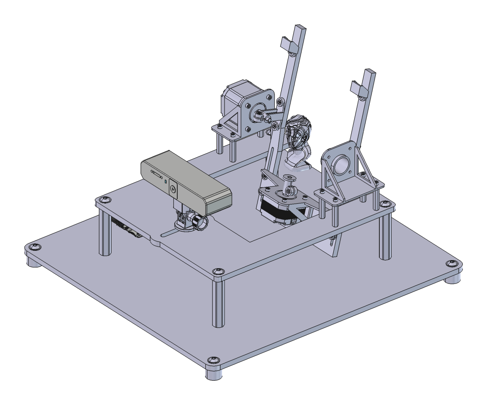
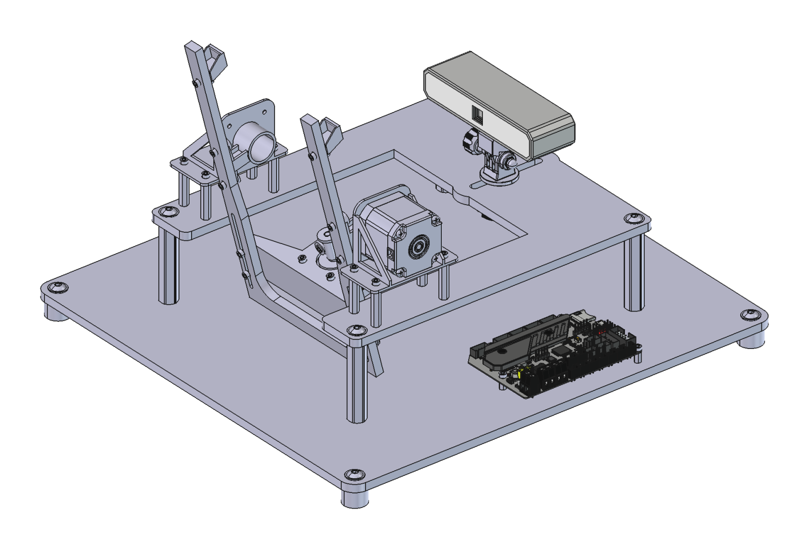

# CAD

FreeCAD 1.1 models of the stage, and the files sent out for fabrication.
Open `assembly.FCStd` for the whole stage.

Some parts are models from other sources that can't be redistributed here (see
[Missing parts](#missing-parts)), so FreeCAD opens the assemblies without them.
The renders below include them, apart from the example object.

From the scanner's end: the scanner faces the turntable, which rides in the
tilting cradle between the latitude motor and the pivot opposite it.

From the opposite corner, with the control board in front.

## Assemblies

| File | Links together |
|---|---|
| `assembly.FCStd` | Everything below, the scanner on its mount, and an example object |
| `base_plate_assembly.FCStd` | `base_plate`, the control board on M3 standoffs, and `bumper`s |
| `lat_lon_assembly.FCStd` | `lat_lon_plate`, `lat_stepper_arm`, `counter_weight_clamp` and `stepper_lon_assembly` |
| `stepper_lat_assembly.FCStd` | `stepper_lat_mount` on M3 standoffs |
| `stepper_lon_assembly.FCStd` | `stepper_lon_mount`, `stepper_lon` and `lon_plate` |
| `stepper_lat.FCStd`, `stepper_lon.FCStd` | A motor model and its screws |
| `bumper.FCStd`, `standoff_q20_63mm.FCStd` | Hardware: a neoprene bumper, and a 63 mm hex standoff, each with its screw |

## Parts

| File | Exported to | Made as |
|---|---|---|
| `base_plate.FCStd`, `lat_lon_plate.FCStd`, `scanner_mount_plate.FCStd` | DXF, `exports/parts_2D_DXF/` | Ponoko - 6.7mm Amber Bamboo Plywood - Laser Cutting |
| `counter_weight_clamp.FCStd`, `lat_stepper_arm.FCStd` (stepper arm and idle arm), `lon_plate.FCStd`, `stepper_lat_mount.FCStd`, `stepper_lon_mount.FCStd` | STL, `exports/parts_3D_STL/` | Xometry - Nylon 12, White, Color: As Printed, Off White (Natural) |

The counterweights aren't modeled. Each of the two counterweight clamps holds a
piece of 1/2" x 1/2" copper bar about 1.25" (32 mm) long. Both pieces are cut
from one 6" bar, McMaster-Carr [89275K36](https://www.mcmaster.com/89275K36).

## Bill of materials

[`scanner_mount_bom.xlsx`](scanner_mount_bom.xlsx) lists the parts for one
build, on four sheets:

- **McMaster order**: the McMaster-Carr parts and how many of each to order.
- **Full BOM**: every part, including the plates, printed parts, control board,
  motors and motor cables.
- **By sub-assembly**: the counts behind every total. They are the only
  quantities typed in (in blue); the rest are formulas.
- **Notes**: how the parts were counted and measured, and what to check before
  ordering.

Most counts come from `assembly.FCStd`. The counterweights, the motor cables and
the real motors (the model has stand-ins) were added by hand.

## Missing parts

These files are linked from the assemblies but not included:

| File | Contents | Source |
|---|---|---|
| `misc_parts/revopoint_assembled.FCStd` | Revopoint MINI scanner, with a tripod mount and clamp | [Revopoint Mini](https://grabcad.com/library/revopoint-mini-1) and [Revopoint - Pop 3 Set](https://grabcad.com/library/revopoint-pop-3-1) on GrabCAD |
| `bigtree_e3_mini_v3.FCStd` | BigTreeTech SKR Mini E3 V3.0 control board | [BTT E3 SKR MINI V3.0.step](https://github.com/bigtreetech/BIGTREETECH-SKR-mini-E3/blob/master/hardware/BTT%20SKR%20MINI%20E3%20V3.0/3D/BTT%20E3%20SKR%20MINI%20V3.0.step) from BigTreeTech |
| `parts.FCStd` | The example object, a small bust | [Small bust scanned with Revopoint MINI](https://grabcad.com/library/small-bust-scanned-with-revopoint-mini-1) on GrabCAD |
| `parts.FCStd`, `standoff_m3_31mm.FCStd`, `standoff_m3_8mm.FCStd` | Motors, screws, nuts, standoffs, bumpers and a knob | McMaster-Carr, listed below |

The McMaster-Carr parts, each linked to its page (where its CAD model can be
downloaded):

| Part number | Part |
|---|---|
| [6627T64](https://www.mcmaster.com/6627T64) | Stepper motor, standing in for the longitude motor (STEPPERONLINE Nema 17 pancake, 1 A, 17 Ncm) |
| [6627T67](https://www.mcmaster.com/6627T67) | Stepper motor, standing in for the latitude motor (STEPPERONLINE Nema 17, 2 A, 55 Ncm) |
| [7129T33](https://www.mcmaster.com/7129T33) | Five-arm knob |
| [91292A109](https://www.mcmaster.com/91292A109), [91292A111](https://www.mcmaster.com/91292A111), [91292A112](https://www.mcmaster.com/91292A112), [91292A113](https://www.mcmaster.com/91292A113), [91292A114](https://www.mcmaster.com/91292A114) | 18-8 stainless steel socket head screws |
| [91355A081](https://www.mcmaster.com/91355A081) | Black-oxide flanged button head screw |
| [91780A363](https://www.mcmaster.com/91780A363), [95947A004](https://www.mcmaster.com/95947A004), [95947A063](https://www.mcmaster.com/95947A063) | Aluminum female threaded hex standoffs |
| [94150A325](https://www.mcmaster.com/94150A325) | 316 stainless steel hex nut |
| [9546K551](https://www.mcmaster.com/9546K551) | Neoprene bumper |
